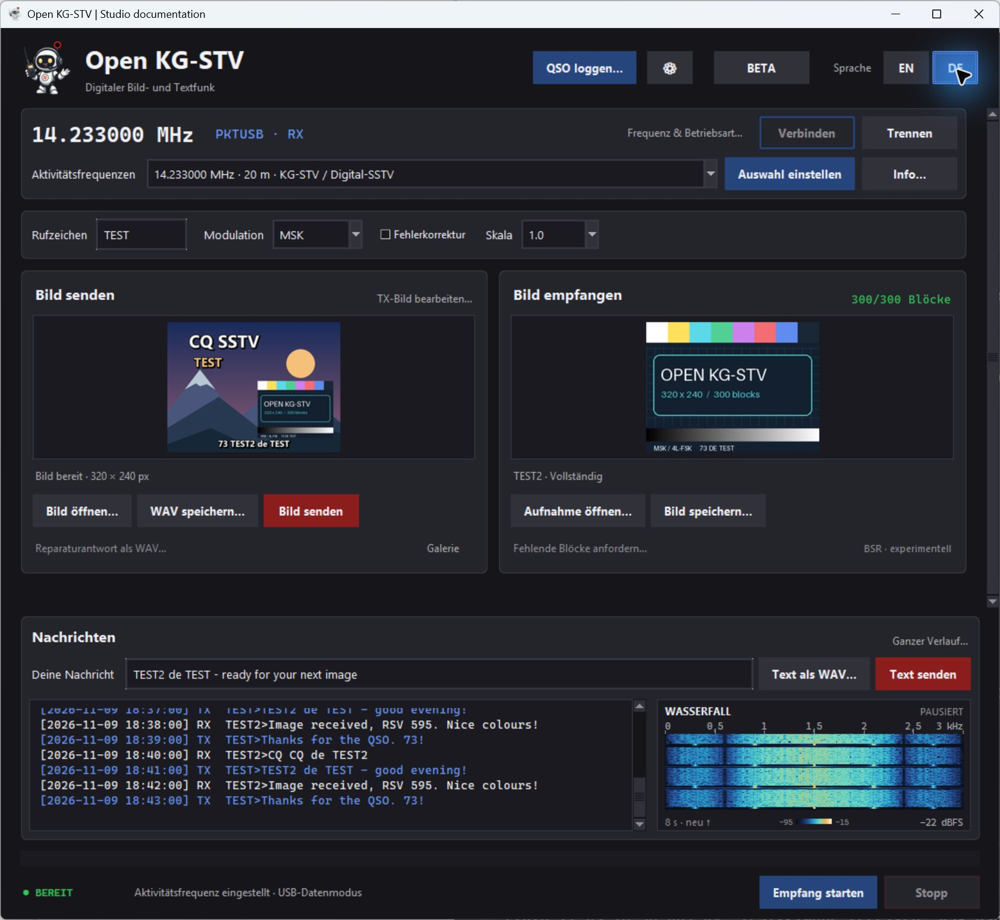
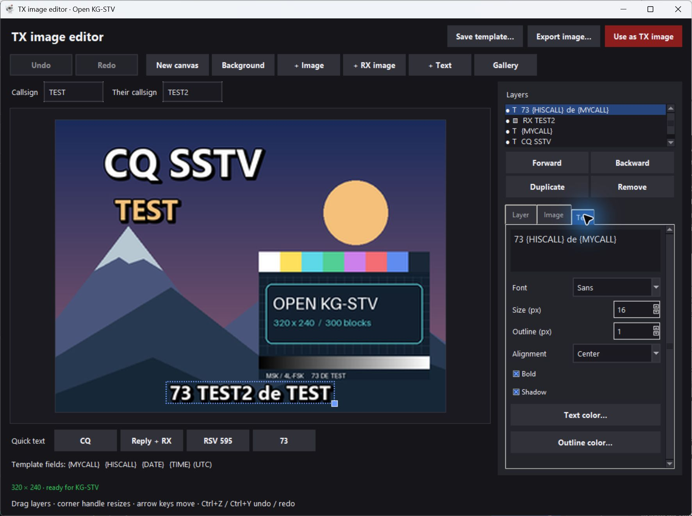
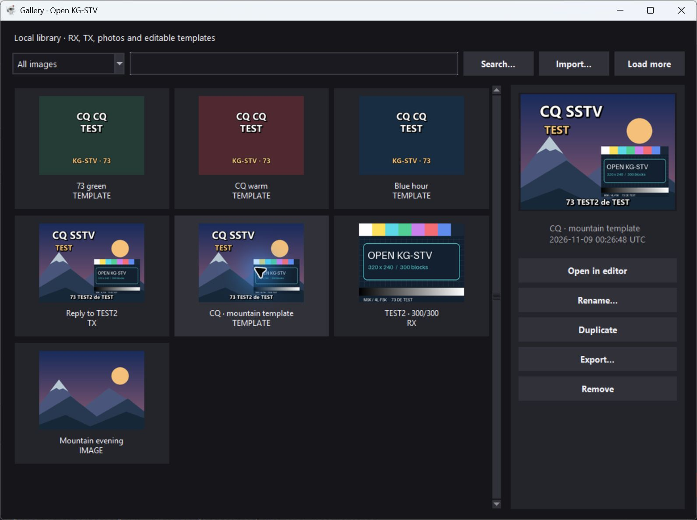
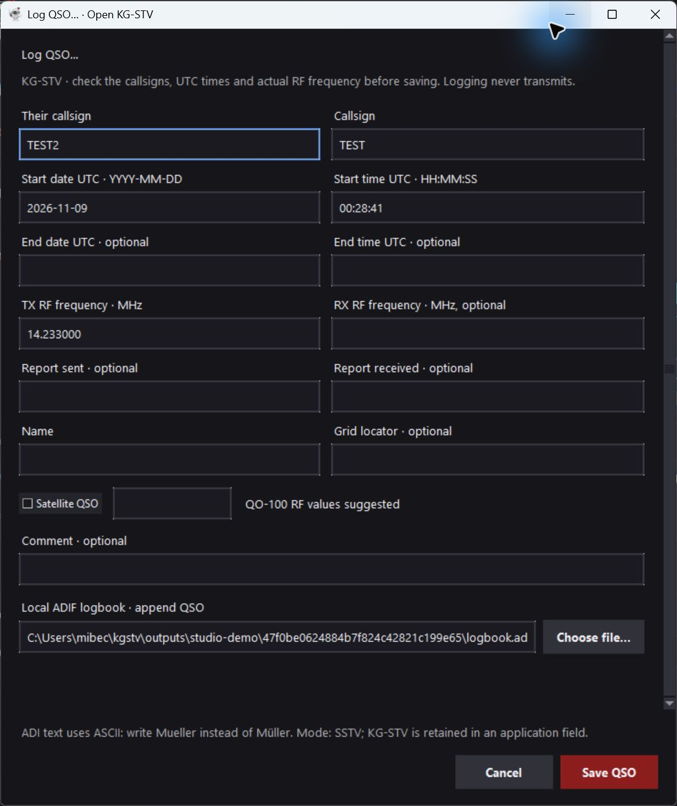

# Open KG-STV

[English](README.md) · **Deutsch**

Eigenständiger Python-Nachbau des digitalen Bildfunkprotokolls von KG-STV.
Der eigene Code steht unter der MIT-Lizenz. Ziel ist Interoperabilität mit
KG-STV 1.0.1 build 004. **Eine vollständige Kompatibilitätszusage gibt es noch
nicht**; die einzelnen Nachweise stehen in [COMPATIBILITY.md](COMPATIBILITY.md).

## Aktueller Funktionsumfang

- MSK und 4L-FSK, jeweils mit oder ohne Faltungscode.
- WAV-/MP3-Empfang, Text und 320×240-Bilder, getrennte CRC-Prüfungen.
- Sender für Text und Bilder, WAV-Export und explizite Soundkartenausgabe.
- Alle 16 Kompressionsskalen; horizontale, vertikale und zufällige Blockfolge.
- Experimentelle BSR-Anfragen, Antworten und Bildreparatur.
- Tk-Oberfläche mit Bildvorschau, Textprotokoll, Live-Empfang und optionalem
  seriellen RTS-/DTR-PTT. Kein Senden beim Start.
- Deutsch/Englisch direkt umschaltbar, mit gespeicherter Sprachauswahl und
  dunkler Gestaltung nach dem Vorbild von HamRig Portal und HamRig Rotor.
- Empfangsberichte mit Paketdaten, Fehlerstatus und fehlenden Bildblöcken.
- Hamlib für USB/CAT und vorhandene rigctld-Server: Frequenz, Betriebsart und
  CAT-PTT, einschließlich IC-7610-USB-Profil. Robbie als Kopf- und Fenstersymbol.
- Operating ohne Reiter; Funkgerät, Audio und PTT liegen hinter **⚙**.
- TX-Bildeditor mit Bildebenen, RX-Collagen, Texten, Bildkorrekturen,
  Rückgängig/Wiederholen und portablen Vorlagen; lokale RX-/TX-/Vorlagengalerie.
- Dauerhafter, durchsuchbarer Nachrichtenverlauf mit Export.
- Kompakter Live-Wasserfall für 0–3 kHz neben dem Chat: acht Sekunden Verlauf,
  Frequenzcursor, Eingangspegel und Übersteuerungsanzeige.
- Recherchierte Aktivitätsfrequenzen und modulares lokales ADIF-QSO-Logging.

Anleitungen: [Bildeditor, Galerie und Chat](docs/IMAGE-STUDIO.md),
[Frequenzen und Quellen](docs/ACTIVITY-FREQUENCIES.md) (Stand 09.11.2026),
[ADIF-Logbuch und Erweiterungsschnittstelle](docs/LOGBOOK.md).

Sechs öffentlich verfügbare Original-Bildaufnahmen werden mit je **300/300
CRC-gültigen Bildblöcken** empfangen. Beide Original-Textaufnahmen werden korrekt
gelesen. Gegen die verlustfreien Referenzbilder bei Scale 1.0 und 0.5 liegt die
maximale Abweichung bei 1 auf der RGB-Skala von 0 bis 255; über 99,5 % der Kanalwerte
sind identisch. Das ersetzt keinen Test unserer Sendesignale im Windows-Original.

## Screenshots

Aufnahmen der laufenden Windows-Oberfläche mit eigenen Testmotiven und isolierten
Beispielkontakten. Die Funkgerätesteuerung ist mit Hamlibs Software-Dummy verbunden.
Diese Szenen sind kein Nachweis von Funkempfang oder Original-Kompatibilität.

**Operating:** Frequenzwahl, TX/RX, QSO-Logging, dauerhaft sichtbarer Chat und
Audio-Wasserfall. Der Wasserfall zeigt hier ein pausiertes, lokal erzeugtes MSK-Signal.



**Bildeditor:** Beliebige Bilder, Empfangsbild und bearbeitbare Texte kombinieren.



**Galerie:** Lokale Bilder und portable Vorlagen verwalten.



**QSO loggen:** Geprüfte Angaben an eine lokale ADIF-Datei anhängen.



## Installation und Start

Python 3.11 oder neuer; lokal geprüft mit Python 3.13. Tk muss installiert sein
(bei Python für Windows enthalten; auf manchen Linux-Systemen `python3-tk`).

```console
python -m pip install -e ".[audio,live]"
python -m kgstv gui
```

Unter Windows kann mit vorhandenem Python 3.13 auch `start-gui.cmd` verwendet
werden. Für die reine WAV-Kommandozeile reicht `pip install -e .`.

Die Oberfläche startet standardmäßig auf Englisch. **EN / DE** oben rechts
wechselt die Sprache sofort, auch während eines laufenden Vorgangs. Bilder,
Texteingaben und Geräteeinstellungen bleiben erhalten. Die Sprachauswahl wird
für den nächsten Start gespeichert: unter Windows in
`%APPDATA%/OpenKGSTV/settings.json`, unter macOS in
`~/Library/Application Support/OpenKGSTV/settings.json`, unter Linux in
`$XDG_CONFIG_HOME/OpenKGSTV/settings.json` (Standard: `~/.config`).

Das Hauptfenster konzentriert sich auf den Funkbetrieb. **⚙** öffnet die
Funkgeräte-, Soundkarten-, Frequenzversatz- und PTT-Einstellungen.
Die Oberfläche öffnet beim Start keine Audiogeräte. „Geräte aktualisieren“ listet
Eingänge und Ausgänge. „Empfang starten“ startet den ausgewählten Eingang. Vor dem
Senden einen laufenden Empfang stoppen. „Bild senden“ und „Text senden“ geben
Audio auf dem gewählten Ausgang aus; ein eingetragener PTT-Port wird dabei
aktiviert. Ein leerer PTT-Port bedeutet: keine serielle Steuerung.

## IC-7610 per USB und weitere Funkgeräte

Unter Windows x64 lädt `python tools/fetch_hamlib.py` das offizielle Hamlib-Paket
in den Projektordner und prüft dessen SHA-256. Danach die Oberfläche neu starten.
Unter **⚙ → IC-7610-USB-Profil** den passenden CI-V-COM-Port auswählen,
Baudrate und Adresse abgleichen (Vorgabe: 115200 und 0x98) und **Verbinden** wählen.
Unter **⚙ → Audio & PTT** zusätzlich die USB-Soundkarte des IC-7610 auswählen.

Am IC-7610 für USB-D1 **DATA1 MOD = USB** einstellen. Die vollständige
[Einrichtungsanleitung](docs/HAMLIB.md) beschreibt die weiteren USB-Menüs,
andere Modelle, vorhandene Server und das Verhalten bei Verbindungsfehlern.

Frequenz und Betriebsart werden zurückgelesen und nur auf ausdrücklichen Befehl
gesetzt. Hamlib-CAT-PTT folgt der Audioübertragung einschließlich Stopp und
Fehlerbehandlung. WAV-Export schaltet kein PTT. Eine unbestätigte PTT-Freigabe
wird sichtbar gemeldet. Funkgeräteprofil, Sprache, Rufzeichen, Audio-Gerätenamen
und Logbuchpfad werden gespeichert; **Speichern & schließen** im Setup übernimmt
die Audio-/PTT-Auswahl. Beim Start erfolgt keine automatische Verbindung.
Neben der Einstellungsdatei liegen `library.sqlite3` mit Galerie, Vorlagen,
TX-Entwurf und Nachrichten sowie standardmäßig `logbook.adi` für die QSOs.

Der Wasserfall startet mit **Empfang starten** am gewählten Audioeingang und
zeigt 0–3 kHz vor der Frequenzversatz-Korrektur. Neue Zeilen erscheinen oben;
**Stoppen** hält das Bild an, der nächste Empfang beginnt mit leerem Verlauf.
Er bleibt neben dem Chat sichtbar, auch wenn der Bildbereich gescrollt wird.
Blau/Cyan/Amber zeigen zunehmende Signalstärke auf einer festen Farbskala von
−95 bis −15 dBFS. Rechts unten stehen der Spitzenpegel des Eingangs bzw.
**ÜBERSTEUERT** bei Samples nahe Vollaussteuerung. Mit der Maus lässt sich die
Audiofrequenz ablesen; der Cursor verstellt weder Funkgerät noch Empfangsversatz.

1024 Samples mit Hann-Fenster bei 12 kHz ergeben rund 11,7 Hz pro Frequenzschritt.
Zehn Zeilen pro Sekunde zeigen acht Sekunden Verlauf. Die begrenzte
Vorschauschlange arbeitet unabhängig vom Decoder; graue Zeilen kennzeichnen
Audio-/Vorschaulücken, deren Dauer nicht maßstäblich dargestellt wird.
Die Anzeige arbeitet beim Live-Empfang, nicht beim WAV-Import oder Senden.

Geprüft mit dem echten Hamlib-Dummy-Backend; **der Test an einem physischen
IC-7610 einschließlich USB-Audio und HF steht noch aus**.

## Kommandozeile

Aufnahme empfangen; Bilder und `report.json` landen in einem neuen Ordner:

```console
python -m kgstv decode aufnahme.wav --output empfang
python -m kgstv decode aufnahme.mp3 --output empfang-mp3 --frequency-offset 70
```

Ein positiver Frequenzversatz bedeutet, dass die aufgenommenen Töne zu hoch
liegen. Ein gefüllter Ausgabeordner wird nur mit `--force` erneut verwendet.

Text oder ein Bild als 48-kHz-/16-Bit-Mono-WAV vorbereiten:

```console
python -m kgstv encode-text "Hallo, 73!" --callsign DL0TEST --output text.wav
python -m kgstv encode-image bild.png --callsign DL0TEST --mode 4fsk --fec --scale 0.5 --output bild.wav
```

Diese Befehle öffnen **keine** Soundkarte und schalten **kein** PTT. Die
Rufzeichen in den Beispielen sind Platzhalter. Text muss in CP932/Shift-JIS
darstellbar sein; maximal 510 codierte Bytes einschließlich Rufzeichenpräfix.

Experimentelle Reparatur:

```console
python -m kgstv request-repair empfang/report.json --callsign DL0TEST --output bsr.wav
python -m kgstv decode bsr-vom-partner.wav --output anfrage
python -m kgstv encode-image urspruengliches-bild.png --callsign DL0TEST --repair-request anfrage/report.json --output reparatur.wav
```

Für eine Antwort muss genau das vorher gesendete Bild verwendet werden. Das
Originalprotokoll enthält keine hier nachgewiesene eindeutige Bild-ID. Die
BSR-Sitzungsdetails sind noch nicht gegen das laufende Original geprüft.

## Tests

```console
python tools/fetch_fixtures.py
python -m unittest discover -v
```

Der Download ist ausdrücklich, hashgeprüft und umfasst nur öffentliche
Audio-/Bild-Testdaten. Ohne die Aufnahmen werden die Originalsignal-Tests als
übersprungen gemeldet. Die Fremddateien unter `research/reference/` sind
gitignoriert und werden nicht im Python-Paket ausgeliefert.
Am 9. November 2026 bestanden lokal alle 94 Tests, einschließlich Hamlib-Dummy,
CAT-PTT, Bildeditor, Vorlagen, Galerie, Chat-Persistenz, kompaktem deutschem Layout,
Frequenzwahl, ADIF-Schreiben einschließlich Wiederholung und Fehlerfällen sowie
Wasserfall-Frequenz-/Pegelgenauigkeit, Lücken, Clipping und Empfangssteuerung. Die Oberflächentests benötigen
Tk und einen Bildschirm; ohne grafische Sitzung werden sie übersprungen.

## Aufbau

| Modul | Verantwortung |
|---|---|
| `protocol.py` | Bits, CRC, Whitening, Faltungscode, Header und Kommandos |
| `modem.py` | Phasenkontinuierliche Modulation, Synchronisation, MSK/4L-FSK |
| `imagecodec.py` | KG-STV-spezifischer Bildbitstrom, DCT und Huffman-Codes |
| `session.py` | Bildaufbau, Rufzeichen, Sender und experimentelles BSR |
| `audio.py` | Offline-Audio, WAV/MP3 und Abtastratenkonvertierung |
| `live.py` | Optionale Soundkarte und PTT mit Freigabe im Fehlerfall |
| `waterfall.py` / `waterfall_gui.py` | Begrenzte Audio-Vorschau, FFT und kompakte Wasserfallanzeige |
| `hamlib.py`, `radio_gui.py` | rigctld-Protokoll, Verbindungen, CAT-PTT und Funkgerätesteuerung |
| `activity.py` | Aktivitätsfrequenzen mit Quellen und Einordnung |
| `image_document.py`, `editor_gui.py` | Bildebenen, Rendering, Vorlagen und Editor |
| `library.py`, `library_gui.py` | Lokale SQLite-Galerie und Nachrichtenverlauf |
| `logbook.py`, `logbook_gui.py` | QSO-Datenmodell, austauschbare Logbuch-Anbindung und ADIF-Dialog |
| `cli.py`, `gui.py` | Kommandozeile und Desktop-Oberfläche |
| `i18n.py`, `theme.py` | Übersetzungen, Sprachauswahl und Tk-Gestaltung im HamRig-Stil |

## Herkunft

Primärquelle sind die erhaltenen japanischen Readmes von JJ0OBZ und öffentliche
Testaufnahmen von [SigIDWiki](https://www.sigidwiki.com/wiki/KG-STV). Das Projekt
[multiplatform-KGSTV](https://github.com/barisdinc/multiplatform-KGSTV) lieferte
technische Ansatzpunkte. Sein Python-Forschungscode und seine aus dem Original
extrahierten Filter wurden nicht übernommen. Die hier implementierten
Koeffizienten-, Farb- und Quantisierungskonventionen wurden unabhängig an den
Referenzbildern geprüft. JPEG-Standardtabellen werden aus Pillow gewonnen.

Die MIT-Lizenz dieses Projekts umfasst eigenen Code und eigene Dokumentation,
nicht die separat heruntergeladenen Originalprogramme, Bilder oder Aufnahmen.
Robbie stammt aus HamRig Portal; die [Herkunftsnotiz](kgstv/assets/README.md)
beschreibt das separat behandelte Markenmotiv. Hamlib bleibt eine externe
Abhängigkeit unter seinen eigenen Lizenzen.
