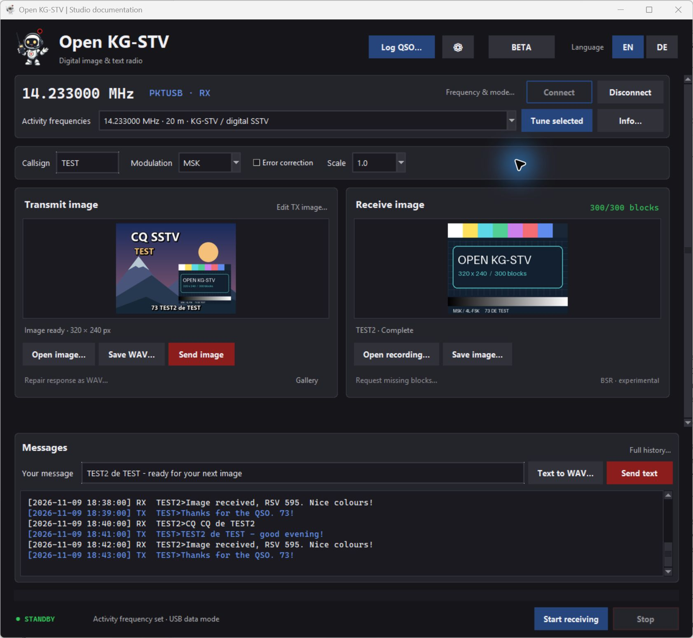
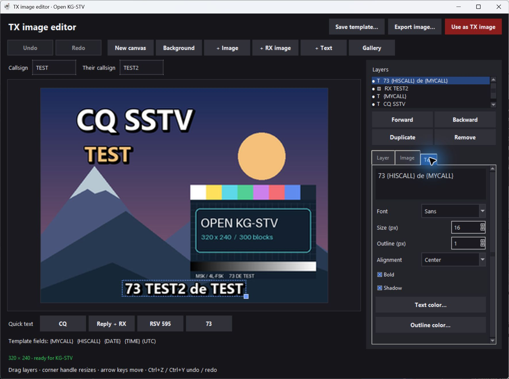
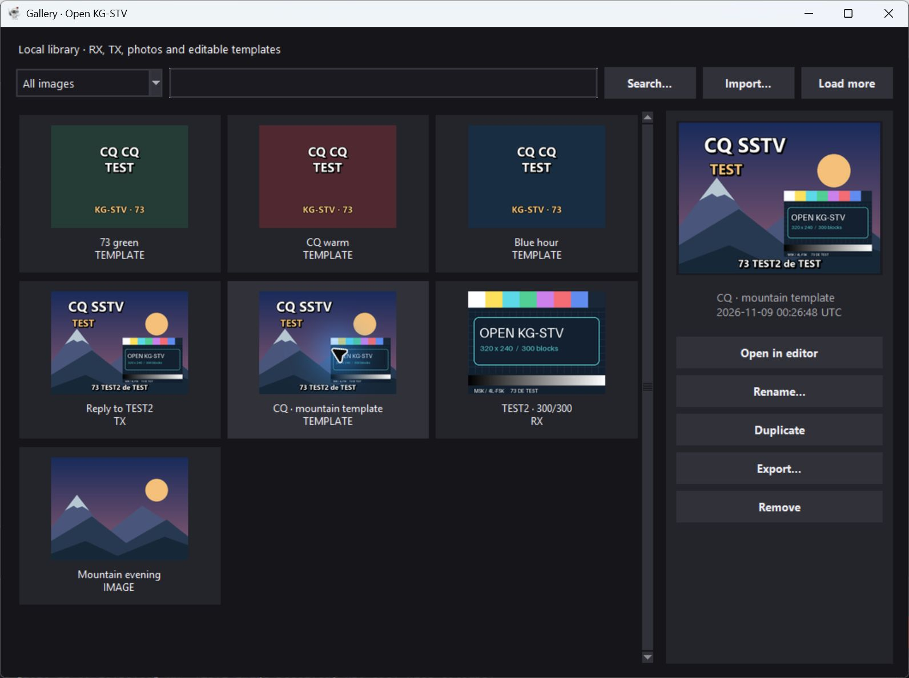
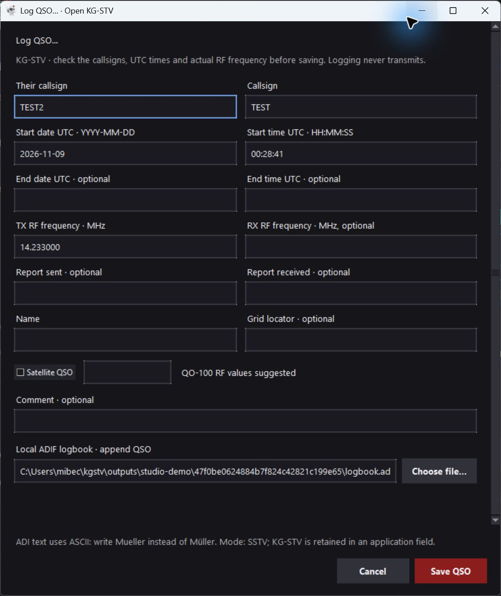
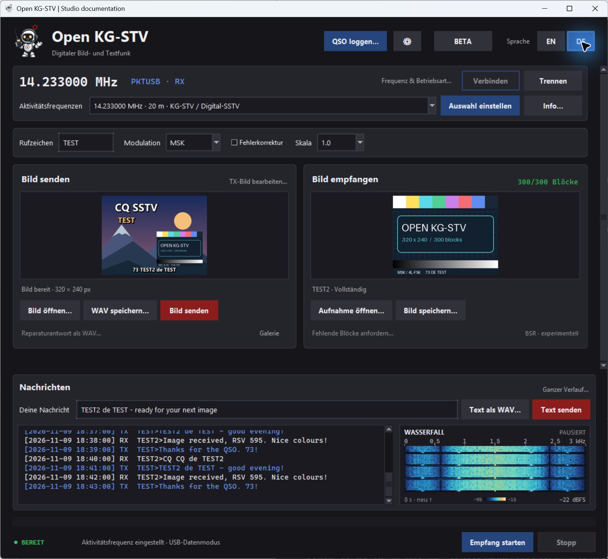

# Open KG-STV

**English** · [Deutsch](README.de.md)

An independent, open-source Python implementation of the KG-STV digital image
and text protocol, released under the [MIT license](LICENSE).

The interoperability target is **KG-STV 1.0.1 build 004**. Original recordings
already decode successfully, but **full compatibility is not yet established**.
Transmission into the original application, BSR interoperability and radio
hardware tests are still pending.

## Features

- MSK and 4L-FSK, each with or without convolutional error correction.
- Text and 320×240 images, with separate header and payload CRC checks.
- Offline reception from WAV/MP3 files and transmission to WAV files.
- All 16 compression scales; horizontal, vertical and random image block order.
- Experimental block repair requests and responses (BSR).
- A Tk desktop interface with image previews, received text, live audio input,
  explicit audio playback and optional serial RTS/DTR PTT.
- Hamlib radio control: local USB/CAT or an existing rigctld server, frequency
  and mode control, CAT PTT, and an IC-7610 USB preset.
- English/German interface switching without restarting, with a remembered
  language preference, a dark HamRig-inspired design and the Robbie mascot.
- A dedicated operating window without navigation tabs; radio/audio/PTT setup behind **⚙**.
- A layered TX image editor: photos, RX collages, text, crop/colour adjustments,
  undo/redo and portable templates, plus a local RX/TX/photo/template gallery.
- Persistent RX/TX message history with search and text export.
- A compact live 0–3 kHz audio waterfall beside the chat, with an eight-second
  history, frequency cursor, input peak level and clipping indicator.
- Researched activity-frequency presets and modular local ADIF QSO logging.
- JSON reception reports with packet details, errors and missing image blocks.

English is the default interface language. Use **EN / DE** at the top right to
switch immediately. Images, message drafts, device selections and an active
operation remain intact. The main window focuses on operating; **⚙** opens
radio, soundcard, receive-offset and PTT settings. Frequency selection, connect,
image editing, messages and **Log QSO…** remain directly accessible.

See the [image studio guide](docs/IMAGE-STUDIO.md),
[activity-frequency research](docs/ACTIVITY-FREQUENCIES.md) (reviewed 2026-11-09),
and [ADIF logbook guide](docs/LOGBOOK.md).

## Screenshots

Actual Windows application screenshots with original project artwork and isolated
sample contacts. Radio control uses the real Hamlib **Dummy** software backend;
these scenes are not evidence of on-air reception or original-KG-STV interoperability.

### Operating

Frequency presets, TX/RX images, QSO logging, pinned chat and an audio waterfall.
The waterfall in these screenshots shows a paused, locally generated MSK signal.



### Image editor and gallery

Compose a picture from arbitrary images, received pictures and editable text.





### QSO logging



See [screenshot reproduction notes](docs/screenshots/README.md) for the demo scenes.

The same interface in German, after switching without restarting:



## Download and run

[Unsigned standalone preview v0.1.0](https://github.com/DH5DAX/open-kgstv/releases/tag/v0.1.0)
— unpack and start, without installing Python:

| System | Download |
|---|---|
| Windows 10/11 x64 | [Windows ZIP](https://github.com/DH5DAX/open-kgstv/releases/download/v0.1.0/OpenKGSTV-0.1.0-windows-x64.zip) |
| Linux x64, Debian 12 / Ubuntu 24.04 or newer compatible desktop | [Linux x64 package](https://github.com/DH5DAX/open-kgstv/releases/download/v0.1.0/OpenKGSTV-0.1.0-linux-x64.tar.gz) |
| 64-bit Raspberry Pi OS Bookworm or newer / compatible ARM64 desktop | [Raspberry Pi / ARM64 package](https://github.com/DH5DAX/open-kgstv/releases/download/v0.1.0/OpenKGSTV-0.1.0-linux-arm64.tar.gz) |

Double-click `OpenKGSTV.exe` on Windows; run `./OpenKGSTV` on Linux.
Each archive contains a single executable plus README, licence notices and
build metadata. [SHA-256 checksums](https://github.com/DH5DAX/open-kgstv/releases/download/v0.1.0/SHA256SUMS.txt)
and [build instructions](packaging/BUILDING.md) are available. The binaries are
unsigned; ARM64 requires a 64-bit OS. Hamlib remains a separate optional
installation or network service. Linux requires a graphical desktop and its
usual system/audio libraries. Physical Raspberry Pi testing remains pending.

## Install and run from source

Requires **Python 3.11 or newer**; tested locally with Python 3.13. Tk must be
available: it is included with standard Python installations on Windows, while
some Linux distributions provide it as `python3-tk`.

```console
git clone https://github.com/DH5DAX/open-kgstv.git
cd open-kgstv
python -m pip install -e ".[audio,live]"
python -m kgstv gui
```

On Windows, `start-gui.cmd` can also launch the application when Python 3.13 is
installed. For WAV-only command-line use, `python -m pip install -e .` is enough.

### IC-7610 USB and other Hamlib radios

On Windows x64, `python tools/fetch_hamlib.py` explicitly downloads and verifies
Hamlib into this checkout. Restart the GUI, open **⚙ → IC-7610 USB profile**,
select the radio's CI-V COM port and match its baud rate (preset: 115200, CI-V
0x98). Choose the radio's USB audio input/output under **⚙ → Audio & PTT**.

See the [complete setup guide](docs/HAMLIB.md) for the IC-7610 menu settings,
other radios, existing rigctld servers and PTT behavior. CAT control has been
tested against the real Hamlib Dummy backend; physical radio testing is pending.

### Desktop controls

| Label in the application | Action |
|---|---|
| Callsign | Your callsign |
| Open image… | Open an image for transmission |
| Save WAV… / Text to WAV… | Save image or text transmission as a WAV file |
| Open recording… | Decode an audio recording |
| Save image… | Save the received image |
| ⚙ → Audio & PTT → Refresh devices | List available audio devices |
| Start receiving | Start reception from the selected input |
| Waterfall | Live 0–3 kHz input spectrum; hover to read a frequency |
| Send image / Send text | Play the transmission on the selected output |
| Stop | Stop the current operation |
| Error correction | Enable convolutional error correction |
| Receive offset (Hz) | Correct a known receive frequency offset |
| Serial port | Serial PTT port; leave blank to disable PTT |
| Connect / Disconnect | Open or close the configured CAT connection |
| Frequency & mode… | Explicitly change radio frequency or mode |
| Activity frequencies → Tune selected | Set a published meeting point and USB data mode |
| ⚙ → Hamlib CAT PTT | Key the connected radio during audio transmission |
| ⚙ → PTT off / RX | Stop playback and request receive |
| Edit TX image… / Gallery | Compose pictures and manage local images/templates |
| Full history… | Search, browse and export persistent RX/TX messages |
| Log QSO… | Append a reviewed QSO to a local ADIF file |
| EN / DE | Switch and remember the interface language |

The application opens no audio devices at startup. Stop reception before
transmitting. Clicking a send button plays audio and activates the configured
PTT method, if any. With Hamlib PTT selected, sending requires a connected radio.
WAV export remains available without a radio connection.

The waterfall shares the selected receive input and starts with **Start receiving**.
Newest audio appears at the top; **Stop** freezes the view and the next reception
clears it. It remains visible beside the chat when the image workspace scrolls.
Blue/cyan/amber show increasing signal strength on a fixed −95 to −15 dBFS colour
scale. The number at bottom right is the input's peak level; **CLIPPING** indicates
samples near full scale. The cursor only measures audio frequency; it does not
tune the radio or change the receive offset.

The display uses a 1024-sample Hann FFT at 12 kHz (about 11.7 Hz per bin), with
ten rows per second and eight seconds of history. It measures audio before the
decoder's frequency-offset correction. Preview buffering is bounded and separate
from decoding; grey rows mark missing capture/preview audio, whose elapsed time
is not represented to scale. It monitors live RX only, not WAV imports or TX.

The language preference is stored in `OpenKGSTV/settings.json` under `%APPDATA%`
on Windows, `~/Library/Application Support` on macOS, or `$XDG_CONFIG_HOME`
(default `~/.config`) on Linux. Radio profiles, callsign, audio-device names and
logbook path share that file. `library.sqlite3` beside it stores images, templates,
the applied TX draft and message history; `logbook.adi` is the default QSO file.
**Save & close** in Setup persists audio/PTT choices. The design follows the
charcoal panels, crimson transmit actions and restrained status colors of HamRig
Portal and HamRig Rotor. The original HamRig Robbie artwork appears in the header
and window icon; see its [provenance note](kgstv/assets/README.md).

## Command line

### Receive a recording

Decoded images and `report.json` are written to the selected directory:

```console
python -m kgstv decode recording.wav --output received
python -m kgstv decode recording.mp3 --output received-mp3 --frequency-offset 70
```

A positive frequency offset means that the recorded tones are too high.
A nonempty output directory requires `--force` before named output files can
be replaced.

### Prepare a transmission

Write a 48 kHz, 16-bit mono WAV file:

```console
python -m kgstv encode-text "Hello, 73!" --callsign DL0TEST --output text.wav
python -m kgstv encode-image image.png --callsign DL0TEST --mode 4fsk --fec --scale 0.5 --output image.wav
```

These commands only write files: they do not open a sound device or activate PTT.
The example callsign is a placeholder. Text must be encodable as CP932/Shift-JIS,
with a maximum of 510 encoded bytes including the callsign prefix.

### Experimental block repair

```console
python -m kgstv request-repair received/report.json --callsign DL0TEST --output bsr.wav
python -m kgstv decode partner-bsr.wav --output request
python -m kgstv encode-image original-image.png --callsign DL0TEST --repair-request request/report.json --output repair.wav
```

A repair response must use the same image that was originally transmitted.
No unique image identifier has been established for this protocol. BSR session
behavior has not yet been validated against the running original application.

## Compatibility and validation

| Check | Status |
|---|---|
| Six public original image recordings | 300/300 CRC-valid image blocks in each |
| Two public original text recordings | Both decoded correctly |
| Scale 1.0 and 0.5 reference PNGs | Maximum channel error of 1 on the 0–255 scale; over 99.5% of channel values identical |
| Own transmitter → own receiver | Tested in all four modulation/FEC combinations |
| Own transmitter → original KG-STV | Pending |
| BSR and all compression scales against the original | Pending |
| Live audio and PTT on radio hardware | Implemented, not hardware-tested |

99 automated tests passed locally on November 9, 2026, including Hamlib protocol,
PTT failure handling, real Hamlib Dummy control, language switching, saved
profiles, GUI WAV export, layered templates, library/history persistence,
compact German layouts, frequency presets, ADIF append/retry/failure cases and
waterfall frequency/level calibration, gaps, clipping and receive lifecycle. The original recordings
are a small, clean sample set; they do not establish receiver performance under
fading, multipath, clipping, clock drift or Doppler. Automatic AFC,
Windows INI compatibility and original image-processor IPC are not implemented.

The detailed [compatibility record](COMPATIBILITY.md) is currently in German.

## Tests

```console
python tools/fetch_fixtures.py
python -m unittest discover -v
```

The explicit fixture download retrieves public audio/image test data and checks
their SHA-256 hashes. Original-recording tests are reported as skipped when the
recordings are absent. Install the `audio` extra to decode the MP3 fixtures.
Desktop tests require Tk and a display; they are skipped in headless environments.

Downloaded third-party material under `research/reference/` is ignored by Git
and excluded from the Python package.

## Project layout

| Module | Responsibility |
|---|---|
| `protocol.py` | Bits, CRC, whitening, convolutional coding, headers and commands |
| `modem.py` | Continuous-phase modulation, synchronization, MSK and 4L-FSK |
| `imagecodec.py` | KG-STV image bitstream, DCT and Huffman coding |
| `session.py` | Image assembly, callsigns, transmission and experimental BSR |
| `audio.py` | Offline WAV/MP3 handling and sample-rate conversion |
| `live.py` | Optional soundcard and serial PTT support |
| `hamlib.py`, `radio_gui.py` | rigctld protocol, process lifecycle, CAT PTT and radio controls |
| `activity.py` | Sourced, qualified activity-frequency presets |
| `image_document.py`, `editor_gui.py` | Layered compositions, rendering, templates and editor |
| `library.py`, `library_gui.py` | SQLite image library and persistent message history |
| `logbook.py`, `logbook_gui.py` | QSO domain, replaceable backend contract and local ADIF writer/dialog |
| `cli.py`, `gui.py` | Command-line and desktop interfaces |
| `i18n.py`, `theme.py` | English/German translations, preferences and HamRig-inspired Tk styling |

## Sources and licensing

Primary sources are JJ0OBZ's preserved Japanese readmes and public test
recordings from [SigIDWiki](https://www.sigidwiki.com/wiki/KG-STV).
[multiplatform-KGSTV](https://github.com/barisdinc/multiplatform-KGSTV) provided
technical starting points. Its Python research decoder and filters extracted
from the original application were not incorporated.

The coefficient, color and quantization conventions implemented here were
independently checked against reference images. Standard JPEG tables are
obtained from Pillow.

The MIT license covers this project's own code, documentation and original
screenshot test card. It does not cover separately downloaded original
programs, images or recordings, or the HamRig branding artwork. Hamlib is an
external dependency distributed under its own licenses.
