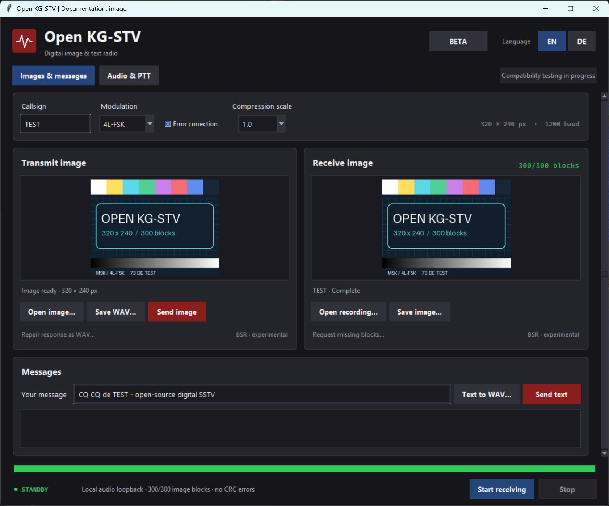
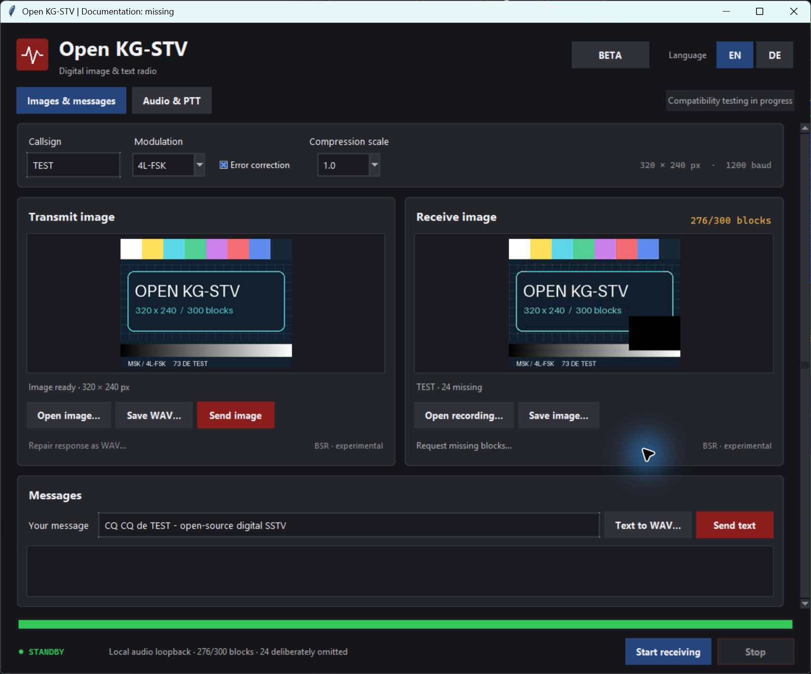
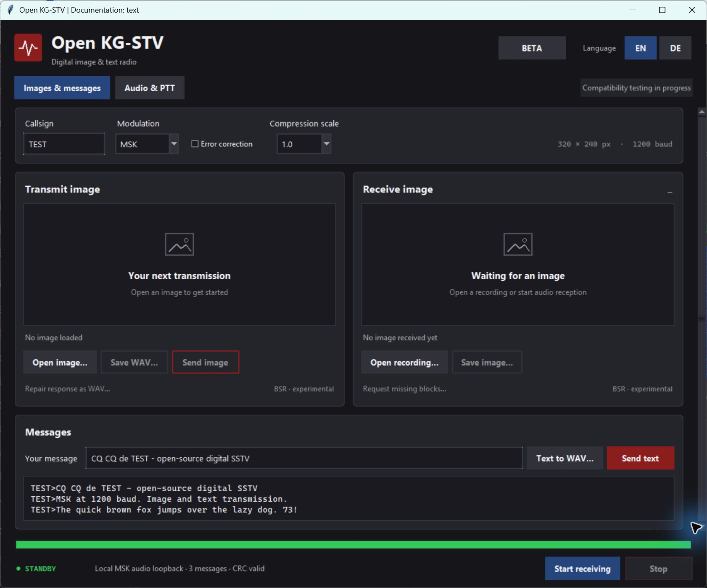
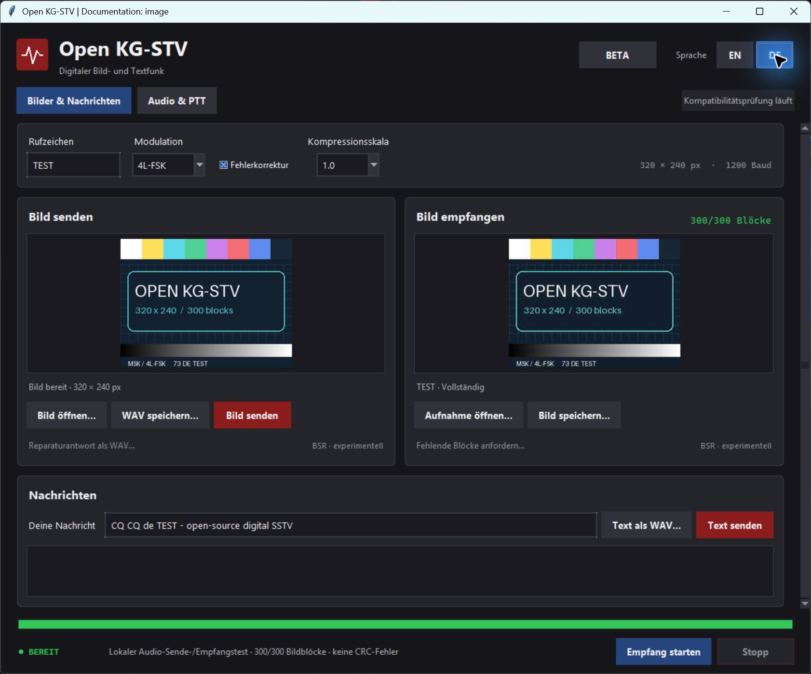

# Open KG-STV

**English** · [Deutsch](README.de.md)

An independent, open-source Python implementation of the KG-STV digital image
and text protocol, released under the [MIT license](LICENSE).

The interoperability target is **KG-STV 1.0.1 build 004**. Original recordings
already decode successfully, but **full compatibility is not yet established**.
Transmission into the original application, BSR interoperability and radio
hardware tests are still pending.

## Features

- MSK and 4L-FSK, each with or without convolutional error correction.
- Text and 320×240 images, with separate header and payload CRC checks.
- Offline reception from WAV/MP3 files and transmission to WAV files.
- All 16 compression scales; horizontal, vertical and random image block order.
- Experimental block repair requests and responses (BSR).
- A Tk desktop interface with image previews, received text, live audio input,
  explicit audio playback and optional serial RTS/DTR PTT.
- English/German interface switching without restarting, with a remembered
  language preference and a dark HamRig-inspired design.
- JSON reception reports with packet details, errors and missing image blocks.

English is the default interface language. Use **EN / DE** at the top right to
switch immediately. Images, message drafts, device selections and an active
operation remain intact. **Images & messages** contains the operating controls;
**Audio & PTT** contains soundcard, receive offset and serial PTT settings.

## Screenshots

Actual screenshots of the Windows application. The original test card was
created for this project. These scenes decode audio generated by our own modem;
they demonstrate local operation, not interoperability with the original KG-STV.

### Complete image reception

4L-FSK with convolutional error correction: **300/300 image blocks received**.



### Missing image blocks

24 blocks were deliberately omitted before modulation. The receiver retains the
other **276/300 blocks** and offers an experimental BSR request.



### Text reception

Three MSK messages decoded into the receive log.



See [screenshot reproduction notes](docs/screenshots/README.md) for the demo scenes.

The same interface in German, after switching without restarting:



## Install and run

Requires **Python 3.11 or newer**; tested locally with Python 3.13. Tk must be
available: it is included with standard Python installations on Windows, while
some Linux distributions provide it as `python3-tk`.

```console
git clone https://github.com/DH5DAX/open-kgstv.git
cd open-kgstv
python -m pip install -e ".[audio,live]"
python -m kgstv gui
```

On Windows, `start-gui.cmd` can also launch the application when Python 3.13 is
installed. For WAV-only command-line use, `python -m pip install -e .` is enough.

### Desktop controls

| Label in the application | Action |
|---|---|
| Callsign | Your callsign |
| Open image… | Open an image for transmission |
| Save WAV… / Text to WAV… | Save image or text transmission as a WAV file |
| Open recording… | Decode an audio recording |
| Save image… | Save the received image |
| Audio & PTT → Refresh devices | List available audio devices |
| Start receiving | Start reception from the selected input |
| Send image / Send text | Play the transmission on the selected output |
| Stop | Stop the current operation |
| Error correction | Enable convolutional error correction |
| Receive offset (Hz) | Correct a known receive frequency offset |
| Serial port | Serial PTT port; leave blank to disable PTT |
| EN / DE | Switch and remember the interface language |

The application opens no audio devices at startup. Stop reception before
transmitting. Clicking a send button plays audio and activates the configured
PTT line, if any.

The language preference is stored in `OpenKGSTV/settings.json` under `%APPDATA%`
on Windows, `~/Library/Application Support` on macOS, or `$XDG_CONFIG_HOME`
(default `~/.config`) on Linux. No callsign, messages or device settings are
written to that file. The design follows the charcoal panels, crimson transmit
actions and restrained status colors of HamRig Portal and HamRig Rotor; it does
not require either application or bundle their assets.

## Command line

### Receive a recording

Decoded images and `report.json` are written to the selected directory:

```console
python -m kgstv decode recording.wav --output received
python -m kgstv decode recording.mp3 --output received-mp3 --frequency-offset 70
```

A positive frequency offset means that the recorded tones are too high.
A nonempty output directory requires `--force` before named output files can
be replaced.

### Prepare a transmission

Write a 48 kHz, 16-bit mono WAV file:

```console
python -m kgstv encode-text "Hello, 73!" --callsign DL0TEST --output text.wav
python -m kgstv encode-image image.png --callsign DL0TEST --mode 4fsk --fec --scale 0.5 --output image.wav
```

These commands only write files: they do not open a sound device or activate PTT.
The example callsign is a placeholder. Text must be encodable as CP932/Shift-JIS,
with a maximum of 510 encoded bytes including the callsign prefix.

### Experimental block repair

```console
python -m kgstv request-repair received/report.json --callsign DL0TEST --output bsr.wav
python -m kgstv decode partner-bsr.wav --output request
python -m kgstv encode-image original-image.png --callsign DL0TEST --repair-request request/report.json --output repair.wav
```

A repair response must use the same image that was originally transmitted.
No unique image identifier has been established for this protocol. BSR session
behavior has not yet been validated against the running original application.

## Compatibility and validation

| Check | Status |
|---|---|
| Six public original image recordings | 300/300 CRC-valid image blocks in each |
| Two public original text recordings | Both decoded correctly |
| Scale 1.0 and 0.5 reference PNGs | Maximum channel error of 1 on the 0–255 scale; over 99.5% of channel values identical |
| Own transmitter → own receiver | Tested in all four modulation/FEC combinations |
| Own transmitter → original KG-STV | Pending |
| BSR and all compression scales against the original | Pending |
| Live audio and PTT on radio hardware | Implemented, not hardware-tested |

39 automated tests passed locally on November 6, 2026, including language
switching, preference persistence and GUI WAV export. The original recordings
are a small, clean sample set; they do not establish receiver performance under
fading, multipath, clipping, clock drift or Doppler. Automatic AFC, a waterfall,
Windows INI compatibility and original image-processor IPC are not implemented.

The detailed [compatibility record](COMPATIBILITY.md) is currently in German.

## Tests

```console
python tools/fetch_fixtures.py
python -m unittest discover -v
```

The explicit fixture download retrieves public audio/image test data and checks
their SHA-256 hashes. Original-recording tests are reported as skipped when the
recordings are absent. Install the `audio` extra to decode the MP3 fixtures.
Desktop tests require Tk and a display; they are skipped in headless environments.

Downloaded third-party material under `research/reference/` is ignored by Git
and excluded from the Python package.

## Project layout

| Module | Responsibility |
|---|---|
| `protocol.py` | Bits, CRC, whitening, convolutional coding, headers and commands |
| `modem.py` | Continuous-phase modulation, synchronization, MSK and 4L-FSK |
| `imagecodec.py` | KG-STV image bitstream, DCT and Huffman coding |
| `session.py` | Image assembly, callsigns, transmission and experimental BSR |
| `audio.py` | Offline WAV/MP3 handling and sample-rate conversion |
| `live.py` | Optional soundcard and serial PTT support |
| `cli.py`, `gui.py` | Command-line and desktop interfaces |
| `i18n.py`, `theme.py` | English/German translations, preferences and HamRig-inspired Tk styling |

## Sources and licensing

Primary sources are JJ0OBZ's preserved Japanese readmes and public test
recordings from [SigIDWiki](https://www.sigidwiki.com/wiki/KG-STV).
[multiplatform-KGSTV](https://github.com/barisdinc/multiplatform-KGSTV) provided
technical starting points. Its Python research decoder and filters extracted
from the original application were not incorporated.

The coefficient, color and quantization conventions implemented here were
independently checked against reference images. Standard JPEG tables are
obtained from Pillow.

The MIT license covers this project's own code, documentation and original
screenshot test card. It does not cover separately downloaded original
programs, images or recordings.
